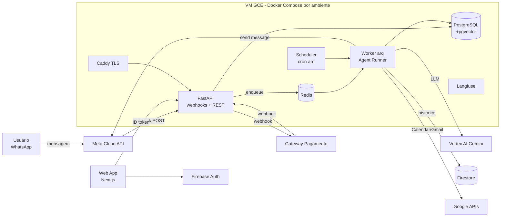
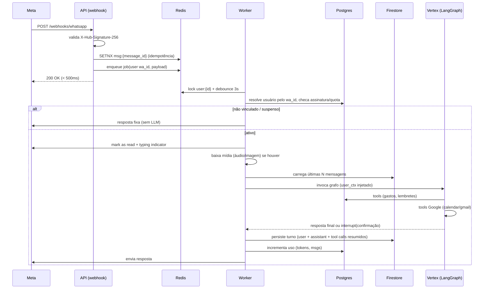

# 04 — Arquitetura

## 1. Decisões de stack (ADR resumido)

| Tema | Escolha | Motivo |
|---|---|---|
| Linguagem | **Python 3.12** | Ecossistema LangChain/LangGraph e SDK do Vertex são mais maduros em Python |
| API | **FastAPI** + Uvicorn | Async, tipado (Pydantic v2), OpenAPI de graça |
| Agente | **LangGraph** (sobre LangChain) + `langchain-google-vertexai` | Grafo explícito com controle de loop, *interrupts* nativos para confirmação humana (RN-04.2) e checkpointing |
| LLM | **Vertex AI: Gemini Flash** (modelo estável mais recente) como principal e **Flash-Lite** para tarefas baratas (classificação, resumo) | Custo/latência, multimodal nativo: **áudio e imagem entram direto no modelo**, sem serviço de STT separado |
| Banco relacional | **PostgreSQL 16** + SQLAlchemy 2 (async) + Alembic + **pgvector** | Dados transacionais (usuários, gastos, assinaturas, lembretes) e memória semântica |
| NoSQL (conversas) | **Firestore (Native mode)**, região `southamerica-east1` | Já vem com o Firebase, serverless, sem ops. Bom para log de mensagens por usuário |
| Estado do agente | `langgraph-checkpoint-postgres` | Pacote oficial e transacional. O Firestore guarda o histórico legível; o Postgres guarda o estado técnico do grafo (interrupts pendentes) |
| Fila / cache / locks | **Redis 7** + **arq** (workers async) | Webhook rápido, processamento assíncrono, lock por usuário, rate limit, debounce |
| Agendamentos | Tabela `scheduled_notifications` no Postgres + *poller* (cron do arq a cada 1 min) | Fonte de verdade durável. Sobrevive a restart do Redis |
| Auth | **Firebase Auth** (web). Backend valida o ID token com `firebase-admin`. Admin via *custom claims* | Pedido do projeto |
| WhatsApp | **Meta WhatsApp Cloud API** atrás da porta `MessagingProvider` | Ver doc 01 |
| Pagamentos | Asaas, Stripe ou Mercado Pago atrás de `BillingProvider` (decisão no Sprint 6) | Pix recorrente + cartão no Brasil |
| Observabilidade | structlog (JSON) + Cloud Monitoring (uptime e alertas) + **Langfuse Cloud** (traces do agente, faixa grátis) + Sentry | Custo zero/baixo |
| Infra | **VM no Compute Engine** (`southamerica-east1`) com Docker Compose rodando **staging e production**, desligada fora do horário comercial + **Caddy** (TLS) + **Terraform** + GitHub Actions + Artifact Registry. Detalhes no doc 12 | Barato, tudo em container e reproduzível. Production ganha VM própria 24/7 antes do beta |
| Qualidade | pytest, pytest-asyncio, testcontainers, Firestore emulator, ruff, mypy, pre-commit | |

> A VM fica na mesma região do Firestore e do Vertex e usa a service account dela (sem chave JSON). O GitHub Actions autentica por Workload Identity Federation.

## 2. Visão de componentes



## 3. Fluxo de uma mensagem



## 4. O agente (LangGraph)

```
START → guard_input → load_context → agent(LLM + tools) ⇄ tools → [needs_confirmation?] → interrupt → respond → END
```

- **guard_input:** rate limit, quota, tamanho máximo, classificador barato de escopo (Flash-Lite) para recusar o que for fora do domínio antes de gastar o modelo principal.
- **load_context:** perfil (nome, fuso, moeda, data/hora atual local), integrações ativas (as tools habilitadas dependem do plano e das conexões), fatos de longo prazo relevantes (pgvector) e as últimas ~20 mensagens.
- **Tools** (cada tool recebe `UserContext` por injeção, **nunca** um `user_id` vindo do LLM):
  - Gastos: `add_expense`, `list_expenses`, `summarize_expenses`, `update_expense`, `delete_expense`, `set_budget`
  - Inteligência financeira (RF-80 a RF-88):
    - `get_spending_overview(period)`: totais, ranking de categorias, variação contra o mês anterior;
    - `set_income` / `add_income`;
    - `set_limit(category|global)`;
    - `get_available_to_spend()`: RN-09.1;
    - `get_month_plan()` / `apply_budget_model(50_30_20)`;
    - `create_goal`, `add_goal_contribution`, `list_goals`;
    - `simulate_purchase(amount, installments, category)`: RN-09.6;
    - `get_insights()`;
    - recorrentes e cartões (RF-90 a RF-94):
      - `add_recurring_expense` / `update_recurring_expense` / `pause_recurring_expense`;
      - `confirm_payment` (previsto → realizado);
      - `add_card(nickname, closing_day, due_day, limit?)`;
      - `add_installment_purchase(description, total, installments, payment_method, card?, due_day?, purchased_on, category, interest?)`;
      - `settle_installments` / `cancel_installments`;
      - `get_invoice(card, month)`;
      - `get_commitments(months=6)`;
      - `set_income` (com `day_rule: fixed|business_day`, `weekend_shift: before|after`, `variable: bool`);
    - Casa (RN-11):
      - `create_household` / `invite_partner` (gera link `wa.me/?text=` para o **titular** encaminhar; nunca envia ao convidado) / `accept_invite(code)` (disparada quando o convidado manda `ENTRAR CASA-XXXX`: vincula o número e grava o opt-in) / `leave_household`;
      - `set_visibility(item, personal|household|split, split_pct?)`;
      - `set_split_rule` / `set_money_mode(mode)` (exige confirmação dos dois);
      - `set_payment_origin(item, joint_account|me)` / `mark_private(item)` / `reveal_private(item)`;
      - `add_joint_entry(kind, amount)` (entrada, aporte, ajuste) / `reconcile_joint_balance(real_balance)` / `reimburse(member, amount)`;
      - `get_joint_account(month)` (saldo, entradas, saídas, previsão);
    - Ajuda (RF-115/116): `search_help(query)` → trechos da Central de Ajuda indexados no pgvector, com `title` e `slug`. A resposta cita o artigo e manda o link. Sem trecho relevante, não inventa.
      - `get_household_overview(month)`;
      - `get_household_balance()`;
      - `settle_up(amount, method)`;
      - `create_household_goal` / `add_household_goal_contribution`.
      - O agente **nunca** expõe dado pessoal do parceiro: as tools da Casa só leem itens `household|split`.

    Todos os cálculos ficam no **domínio** (código determinístico e testado). O LLM só interpreta o pedido e redige a resposta, **nunca faz conta**.
  - Agenda: `list_events`, `create_event`, `update_event`, `delete_event`, `find_free_slots`
  - Lembretes: `create_reminder`, `list_reminders`, `cancel_reminder`
  - E-mail: `list_important_emails`, `search_emails`, `draft_email`, `send_email` (sempre via interrupt)
  - Memória: `remember_fact`, `forget_fact`
  - Sistema: `undo_last_action`
- **Confirmação (RN-04.2):** tools sensíveis chamam `interrupt()`. O estado fica no checkpointer Postgres (thread = `user_id`). A próxima mensagem "sim"/"não" retoma o grafo com `Command(resume=...)`. A confirmação expira em 10 min.
- **Saída estruturada:** tools com schemas Pydantic. Datas sempre ISO 8601 no fuso do usuário. Valores em centavos.

## 5. Modelo de dados

### 5.1 PostgreSQL (principais tabelas)
```
users(id uuid pk, firebase_uid unique, email, name, timezone, currency, locale,
      daily_summary_time, proactive_opt_in bool, created_at, deleted_at)
whatsapp_links(id, user_id fk unique, wa_id unique, linked_at, unlinked_at)
link_codes(code pk, user_id, expires_at, used_at)
plans(id, code, name, price_cents, limits jsonb, active)
subscriptions(id, user_id, plan_id, status, provider, provider_sub_id,
              current_period_start, current_period_end, trial_end, canceled_at)
usage_counters(user_id, period_start, messages, llm_input_tokens, llm_output_tokens,
               proactive_templates, images, pk(user_id, period_start))
categories(id, user_id null=padrão, name, icon)
transactions(id, user_id, kind[expense|income], amount_cents bigint, currency,
             occurred_on date, category_id, description, payment_method,
             installment_group_id, installment_no, installment_total,
             source[text|audio|image], deleted_at, created_at)
budgets(id, user_id, category_id, month date, amount_cents, alerted_80, alerted_100)
incomes(id, user_id, kind[recurring|extra], description, amount_cents, variable bool,
        day_rule[fixed|business_day] null, day_value smallint null, weekend_shift[before|after], received_on null, active)
income_occurrences(id, income_id, expected_on, expected_cents, received_on null, received_cents null)   -- previsto x recebido
recurring_expenses(id, user_id, description, amount_cents, variable bool, day_rule, day_value, weekend_shift,
                   category_id, payment_method[card|pix|boleto|debit], card_id null, active, paused_until null)
credit_cards(id, user_id, issuer[nubank|neon|itau|bradesco|inter|c6|santander|bb|caixa|mercadopago|other], nickname,
             last4 char(4) null, color_skin varchar null, custom_color char(7) null,   -- doc 09
             closing_day smallint, due_day smallint, limit_cents null, active)
invoices(id, card_id, due_on date, closes_on date, status[open|closed|paid], total_cents)   -- materializada a partir dos lançamentos
installment_plans(id, user_id, payment_method[card|boleto|carne|pix_installments|financing], card_id null,
                  due_day_rule null, due_day_value null, first_due_month date null,   -- p/ formas sem fatura
                  description, total_cents, installments smallint, installment_cents, interest_cents,
                  purchased_on date, category_id, status[active|settled|canceled])
-- transactions ganha: card_id null, invoice_id null, installment_plan_id null, installment_no, recurring_expense_id null, status[expected|done]
-- Finanças a dois (RN-11)
households(id, name, owner_user_id, money_mode[joint|separate|mixed], money_mode_confirmed_by uuid[] , split_rule[equal|income_ratio|custom|per_item], custom_pct_owner smallint null, created_at, closed_at null)
household_accounts(id, household_id unique, name, color, opening_balance_cents, opening_on date, created_at)   -- 1 conta conjunta por Casa
household_account_entries(id, account_id, kind[income|contribution|reimbursement|goal_transfer|adjustment], user_id null, amount_cents, occurred_on, note)
household_members(household_id, user_id, role[owner|member], joined_at, left_at null, notify_partner bool, pk(household_id,user_id))
household_invites(code pk, household_id, invited_phone null, status[pending|accepted|expired|canceled], expires_at, used_by null, used_at null, used_from_phone null)
-- invited_phone só pré-preenche e confere; se used_from_phone ≠ invited_phone, o titular confirma antes de liberar
-- transactions/recurring_expenses/installment_plans ganham: visibility[personal|household|split] default 'personal',
--   household_id null, split_pct_author smallint null (só p/ 'split'),
--   paid_from[member|joint_account] default conforme money_mode, private bool default false (só p/ joint_account: parceiro vê valor e autor, nunca descrição/categoria)
-- cards ganha household_id null (cartão da conta conjunta: visível aos dois)
-- Saldo da conjunta = opening + Σ entries(income, contribution, adjustment) − Σ transactions(paid_from=joint_account) − Σ entries(reimbursement, goal_transfer)
-- "Quem deve quem" (separate) ignora paid_from=joint_account; reembolsos (mixed) = Σ itens da casa com paid_from=member − Σ reimbursement
household_shares(transaction_id, user_id, share_cents, pk(transaction_id,user_id))      -- parte de cada um (materializada)
household_settlements(id, household_id, from_user_id, to_user_id, amount_cents, method[pix|cash|carry_over], settled_on, note)
household_goals(id, household_id, name, target_cents, deadline) + household_goal_contributions(goal_id, user_id, amount_cents, contributed_on)
-- Segurança: toda consulta da Casa filtra por household_id E visibility in ('household','split'); RLS no Postgres obrigatório para essas tabelas.
spending_limits(id, user_id, category_id null=geral, month date, amount_cents)   -- substitui budgets
budget_models(user_id pk, needs_pct, wants_pct, savings_pct, category_groups jsonb)
goals(id, user_id, name, target_cents, saved_cents, deadline date, status[active|done|paused], created_at)
goal_contributions(id, goal_id, amount_cents, contributed_on, source[manual|auto])
insights(id, user_id, kind, payload jsonb, period, sent_at null, dismissed_at null)
-- views materializadas: monthly_category_totals(user_id, month, category_id, total_cents) p/ dashboards e insights
oauth_connections(id, user_id, provider[google], scopes text[], 
                  access_token_enc bytea, refresh_token_enc bytea, expires_at, status)
scheduled_notifications(id, user_id, kind[reminder|event|bill|daily_summary|budget],
                        payload jsonb, send_at timestamptz, status, attempts, sent_at)
  -- índice parcial: (send_at) WHERE status='pending'
action_log(id, user_id, action, entity, entity_id, before jsonb, after jsonb,
           reversible_until, undone_at)          -- suporta "desfazer" e auditoria
user_facts(id, user_id, fact text, embedding vector(768), created_at)
processed_webhooks(provider, event_id, processed_at, pk(provider, event_id))
admin_audit(id, admin_uid, action, target_user_id, reason, at)
```
Todas as tabelas de usuário têm índice começando por `user_id`. **RLS** do Postgres como segunda camada de defesa é opcional (fica para o Sprint 7).

### 5.2 Firestore
```
users/{userId}/messages/{messageId}
  { role: user|assistant|system, type: text|audio|image|interactive,
    text, wa_message_id, tool_calls: [{name, ok}], tokens: {in, out},
    created_at, expires_at }          ← TTL policy no campo expires_at (RN-08.1)
```
Consulta padrão: últimas N por `created_at desc`. TTL nativo do Firestore cuida da retenção.

## 6. Estrutura do repositório

```
personal-assistent/
├── docs/                         # este planejamento
├── backend/
│   ├── pyproject.toml            # uv/poetry
│   ├── Dockerfile
│   ├── alembic.ini
│   ├── migrations/
│   ├── src/assistant/
│   │   ├── main_api.py           # entrypoint FastAPI
│   │   ├── main_worker.py        # entrypoint arq (jobs + cron)
│   │   ├── config.py             # pydantic-settings
│   │   ├── domain/               # entidades, regras, ports (sem dependências externas)
│   │   │   ├── users/  expenses/  calendar/  reminders/  email/  billing/
│   │   │   └── ports.py          # MessagingProvider, CalendarProvider, EmailProvider, BillingProvider, ConversationStore...
│   │   ├── application/          # casos de uso (orquestram domínio + ports)
│   │   ├── agent/
│   │   │   ├── graph.py  state.py  prompts/  tools/  guardrails.py
│   │   ├── adapters/
│   │   │   ├── messaging/meta_cloud.py
│   │   │   ├── persistence/postgres/  persistence/firestore/
│   │   │   ├── google/calendar.py  google/gmail.py  google/oauth.py
│   │   │   ├── llm/vertex.py
│   │   │   ├── billing/<provider>.py
│   │   │   └── auth/firebase.py
│   │   ├── api/
│   │   │   ├── webhooks/whatsapp.py  webhooks/billing.py
│   │   │   ├── v1/me.py  v1/integrations.py  v1/admin.py
│   │   │   └── deps.py           # auth, db session
│   │   └── shared/               # crypto, clock, logging, errors
│   └── tests/
│       ├── unit/  integration/  e2e/
│       └── evals/                # golden set do agente
├── web/                          # Next.js (página de vendas, painel, checkout, Central de Ajuda)
├── api/
│   └── openapi.yaml              # contrato da API (doc 13): fonte do mock e do cliente TS
└── infra/
    ├── terraform/                # bootstrap/, modules/, envs/{shared,staging,production} (doc 12)
    ├── compose/                  # dev.yml, base.yml, staging.yml, production.yml, edge.yml (Caddy)
    ├── caddy/Caddyfile
    └── scripts/                  # deploy.sh, backup.sh, restore.sh
```

## 7. Segurança (checklist de arquitetura)
- Assinatura HMAC dos webhooks (Meta e gateway). Verify token no `GET` de subscribe da Meta.
- Segredos no **Secret Manager** de cada ambiente, materializados em `.env` (permissão 600) só no deploy. Nunca no repositório nem no state do Terraform.
- Criptografia de tokens OAuth com envelope (chave mestre fora do banco) e rotação suportada (`key_id` junto do ciphertext).
- Firewall da VM (Terraform): só 80/443 públicas; SSH só pelo IAP. Postgres e Redis **sem porta exposta**.
- Prompt-injection: conteúdo de e-mail entra delimitado como dado. `send_email`/`delete_*` sempre passam por confirmação humana.
- Logs: mascarar telefone, e-mail, valores e conteúdo de mensagens no nível INFO.
